

  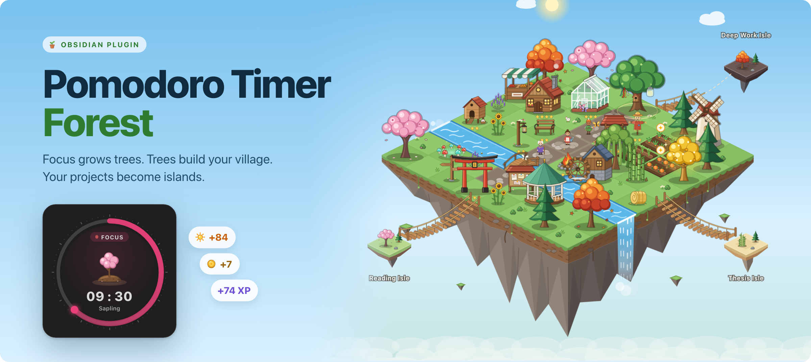

<h3 align="center">
  <a href="https://community.obsidian.md/plugins/pomodoro-timer-forest">Install in Obsidian</a>
  &nbsp;·&nbsp;
  <a href="docs/GUIDE.md">User guide</a>
  &nbsp;·&nbsp;
  <a href="https://github.com/QuantumKuba/obsidian-pomodoro-timer-forest/releases/latest">What's new</a>
</h3>

  
  
  
  

A Pomodoro timer for Obsidian where every session grows a tree, and every tree goes into a small village floating in the sky. Your projects get islands of their own, joined to home by bridges you build with focus.

It's made for brains that tune out a plain countdown and give up on apps that punish a bad week. Progress is something you can see, rewards land the moment a session ends, and nothing you build is ever taken away.

  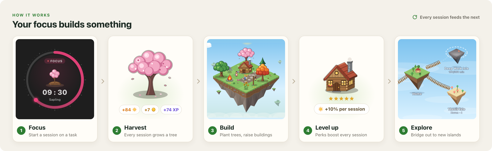

## Watch it grow

Press play and a seed goes into the timer. It sprouts, leafs out and grows into a full tree as the ring fills.

  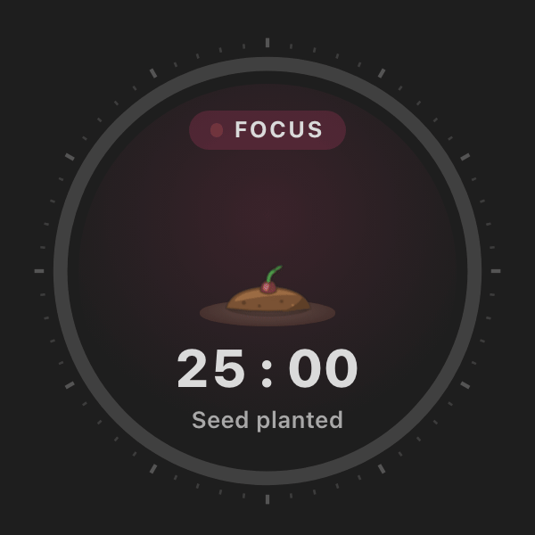

## Islands for the things you work on

New in 1.6

Pick a tag, a folder or a hub note, and an island appears on the horizon for it. The only way across is a bridge built from focus on exactly that subject. Land, and the island keeps growing with every minute and every note you put into it. There's always another one after it.

  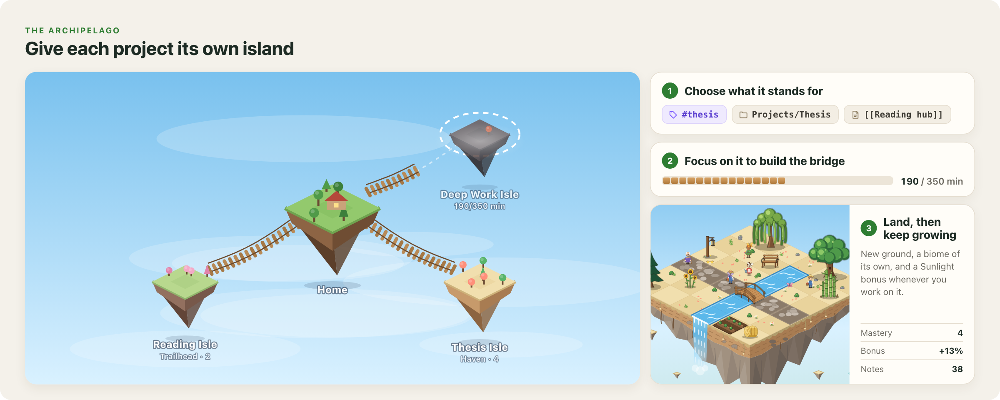

<table>
  <tr>
    <td width="50%">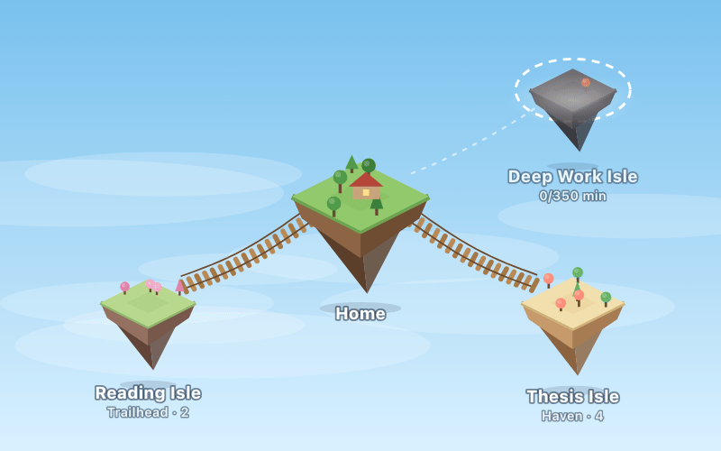</td>
    <td width="50%">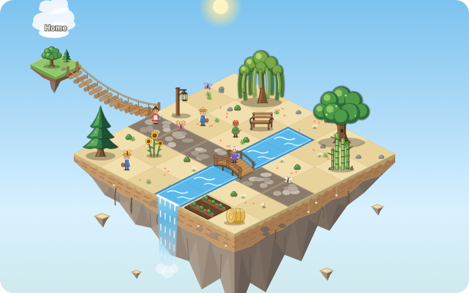</td>
  </tr>
  <tr>
    <td>Sessions on <code>#deep-work</code> lay the bridge plank by plank.</td>
    <td>Each island gets its own land, its own biome and a Sunlight bonus.</td>
  </tr>
</table>

[How islands work →](docs/GUIDE.md#the-archipelago-islands-for-the-things-you-work-on)

## A village that's yours

Spend Sunlight and Coins on buildings with real perks, plant the saplings you harvest, grow crops that ripen as you focus, and expand the land from 5×5 to 8×8. Open it as a full page or keep it under the timer.

  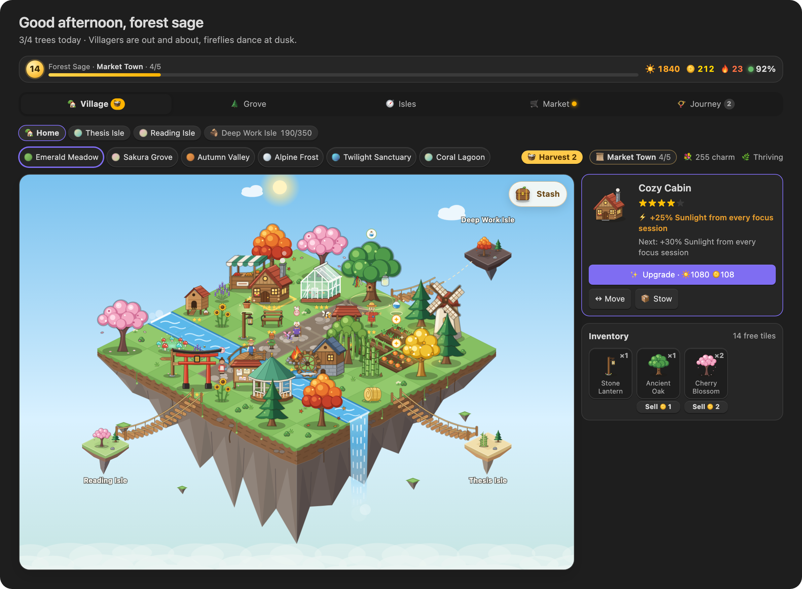

<table>
  <tr>
    <td width="62%" valign="top">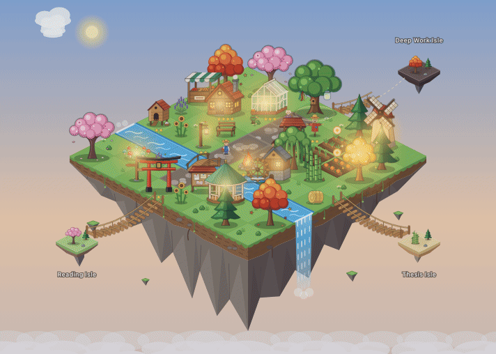</td>
    <td width="38%" valign="top">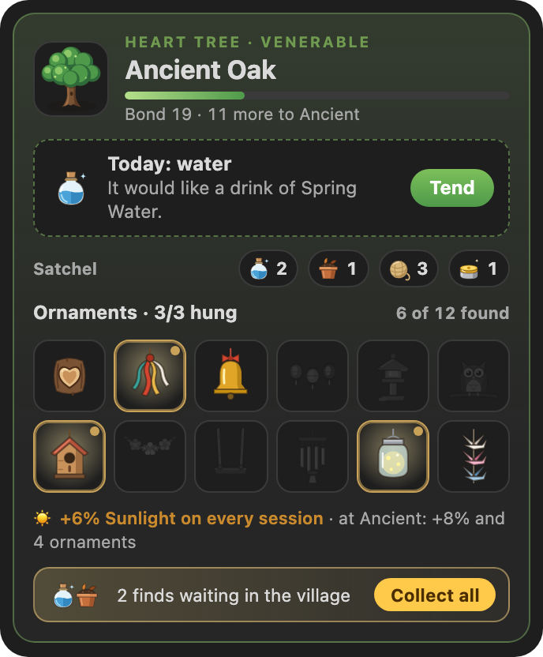</td>
  </tr>
  <tr>
    <td>It runs on your clock. Windows light up at dusk, villagers gather at the campfire after dark.</td>
    <td>Choose a Heart Tree, care for it daily and hang the ornaments you find.</td>
  </tr>
</table>

## Why it works for ADHD brains

Most Pomodoro apps assume you'll stick to the schedule. This one is built around the days you don't.

- **Time you can see.** The tree grows with the countdown, so 25 minutes is something you watch happen instead of a number you ignore.
- **Rewards right away.** Sunlight, Coins and XP the moment a session ends, with every bonus listed.
- **Hyperfocus mode.** When the timer ends mid-flow, keep going. It counts up instead of cutting you off, never withers your tree, nudges you to drink water every 30 minutes, and lets you leave a "where was I" note for later.
- **Streaks that sleep instead of breaking.** Miss a few days and the village naps under a bit of mist. One session wakes it up. Nothing is lost.
- **Done early? Harvest early.** Finished in 12 minutes? Tick the task off and keep 75% of the reward.
- **Start from the task.** Press play on any `- [ ]` task or Kanban card, so starting is one click.

[Hyperfocus mode in detail →](docs/GUIDE.md#hyperfocus-mode-ride-the-wave)

## Something to aim for

The Village Charter takes your settlement from a Clearing to a City in seven ranks, one small chapter of goals at a time. Four neighbours move in along the way and ask for small things tied to your actual work. Nothing expires and ranks are never lost.

  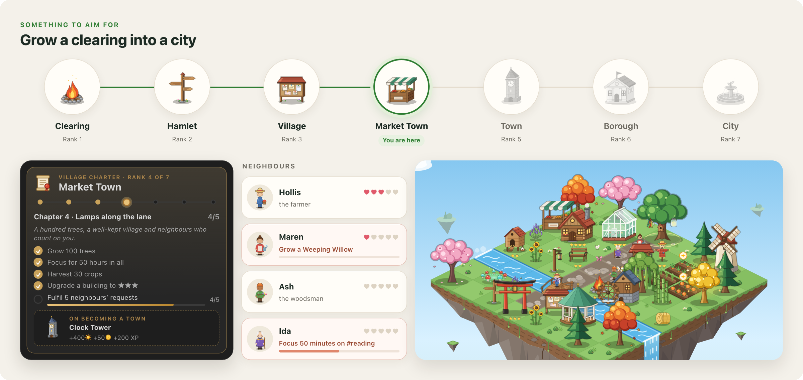

## Kanban boards

Plan in lanes, press play on a card to focus on it, and get paid when it reaches Done. Boards use the [Obsidian Kanban](https://github.com/mgmeyers/obsidian-kanban) file format, so boards you already have open as they are.

  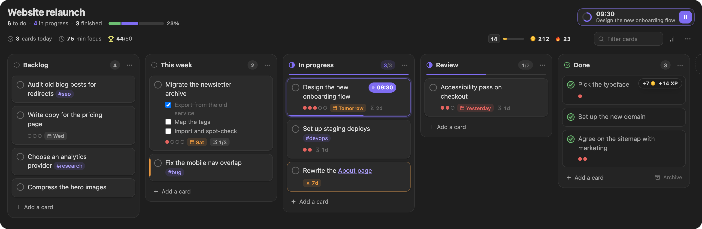

Board statistics, a light theme and a phone layout are in [the guide](docs/GUIDE.md#kanban-boards).

## Right in your sidebar

<table>
  <tr>
    <td width="33%" valign="top">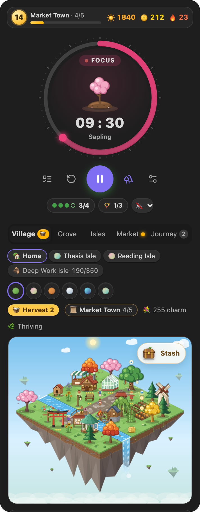</td>
    <td width="33%" valign="top">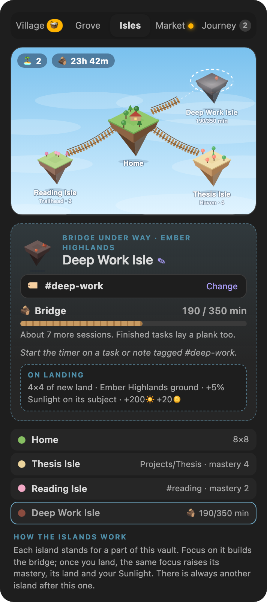</td>
    <td width="33%" valign="top">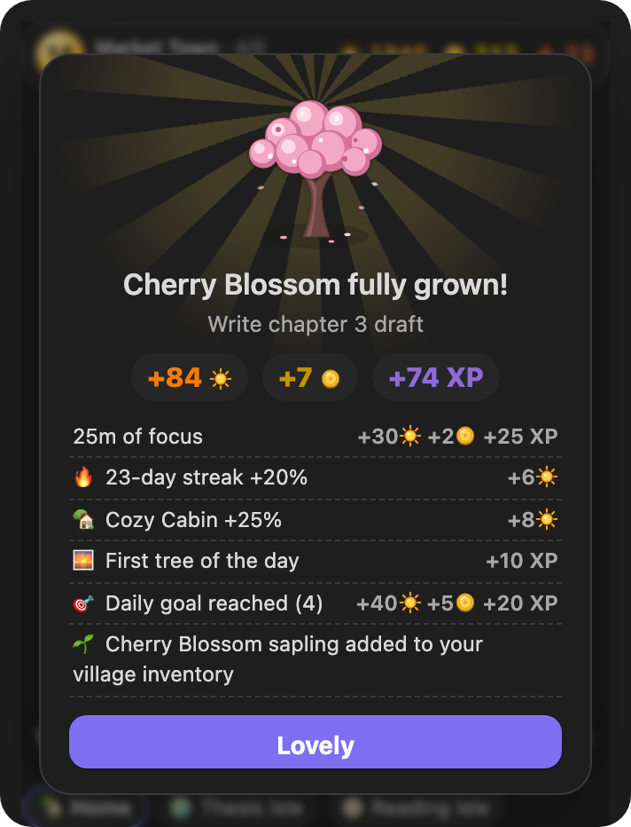  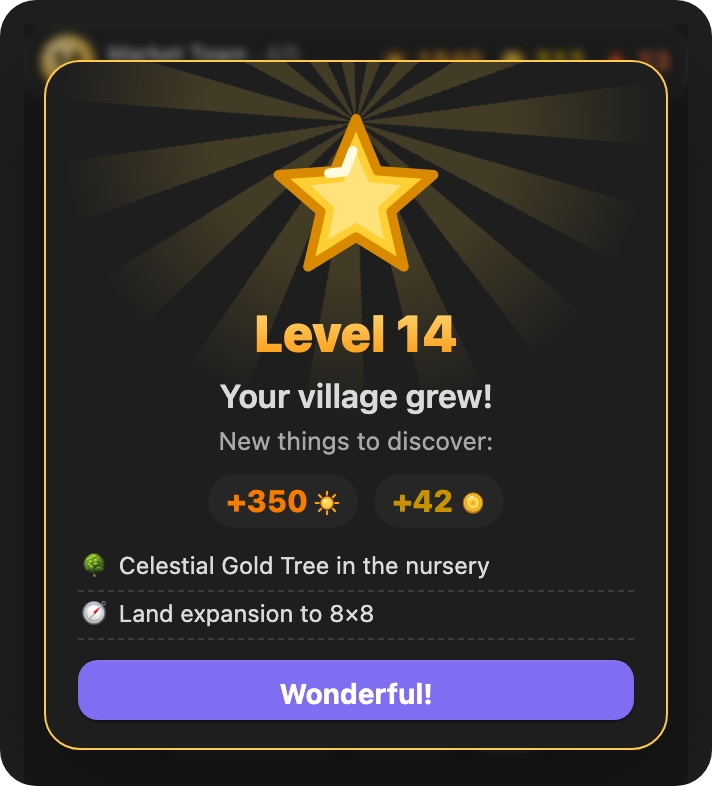</td>
  </tr>
  <tr>
    <td>Timer and village</td>
    <td>Islands</td>
    <td>Harvest and level up</td>
  </tr>
</table>

## Plenty to unlock

Eleven species, two dozen buildings and eight biomes, opened up as you level.

  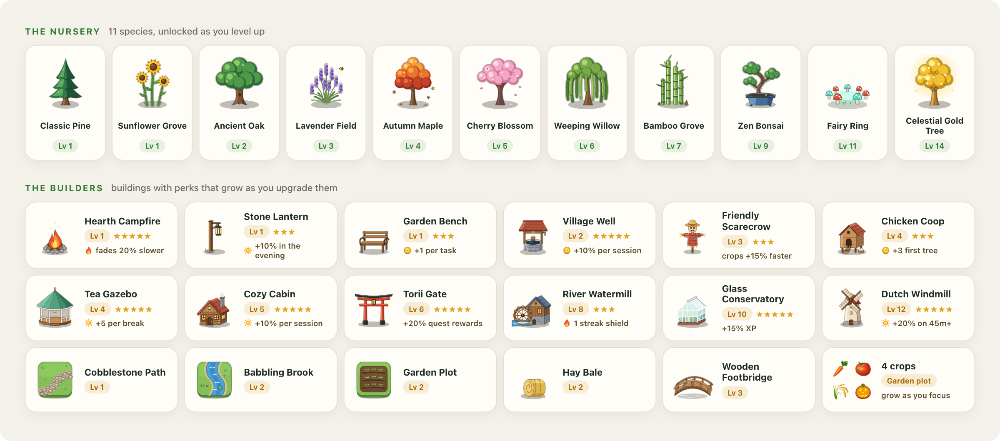

  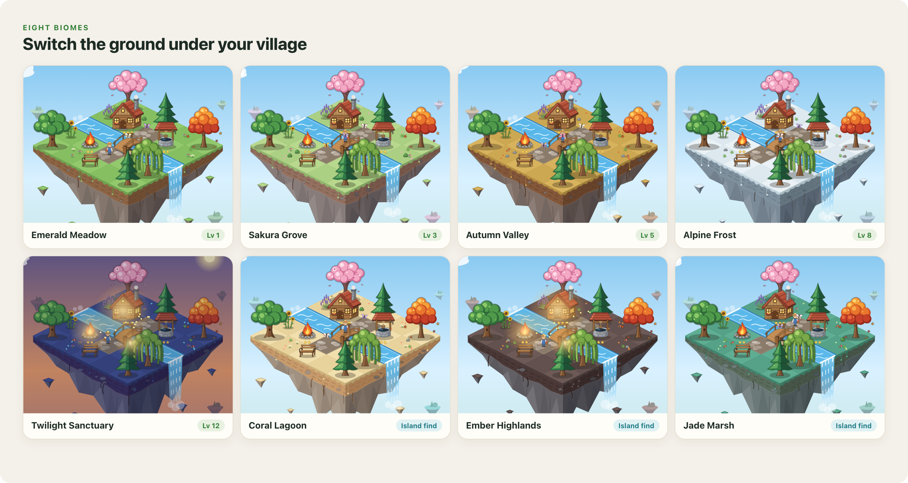

## Also does

- Rewards for ticking off any `- [ ]` task in your vault ([rewards](docs/GUIDE.md#rewards))
- Planned vs. finished pomodoros, start and due dates on tasks ([task tracking](docs/TIMER.md#task-tracking))
- Dataview-friendly logs in your daily notes ([logging](docs/TIMER.md#log))
- Tags pick the seed: `#write` plants a Cherry Blossom, `#code` a Classic Pine ([smart seeds](docs/GUIDE.md#smart-seeds-tags))
- A Grove journal for looking back at any day ([the Grove](docs/GUIDE.md#the-grove-journal))
- Rain, stream and breeze soundscapes, generated in the plugin ([sounds](docs/GUIDE.md#sounds))
- Export your village as a self-contained animated HTML page ([sharing](docs/GUIDE.md#export-and-sharing))

## Install

In Obsidian, open **Settings → Community plugins → Browse**, search for **Pomodoro Timer Forest**, then install and enable it. Or [open it in the plugin directory](https://community.obsidian.md/plugins/pomodoro-timer-forest).

Then click the timer icon in the left ribbon and press play. Your first tree is free, and you start with a few saplings to plant. The [user guide](docs/GUIDE.md) covers the rest.

Manual install

Download `main.js`, `manifest.json` and `styles.css` from the [latest release](https://github.com/QuantumKuba/obsidian-pomodoro-timer-forest/releases/latest), put them in `<your vault>/.obsidian/plugins/pomodoro-timer-forest/`, and enable the plugin under *Settings → Community plugins*.

## Privacy

No account, no server, no tracking. Everything stays in your vault, in `.obsidian/plugins/pomodoro-timer-forest/data.json`. Sync that file with Obsidian Sync, Git or iCloud to carry your village between devices, and back it up before uninstalling if you want to keep it. More in [permissions and privacy](docs/GUIDE.md#permissions-and-privacy) and [using more than one device](docs/GUIDE.md#using-more-than-one-device).

## Credits

Built on [Pomodoro Timer for Obsidian](https://github.com/eatgrass/obsidian-pomodoro-timer) by eatgrass (MIT), which provides the timer, task tracking and logging. The village, islands, hyperfocus mode and boards are built on top. MIT licensed.

Building from source and regenerating these screenshots: [docs/DEVELOPMENT.md](docs/DEVELOPMENT.md). Every image here is drawn by the plugin's own renderer and components.
