# Pomodoro Timer Forest

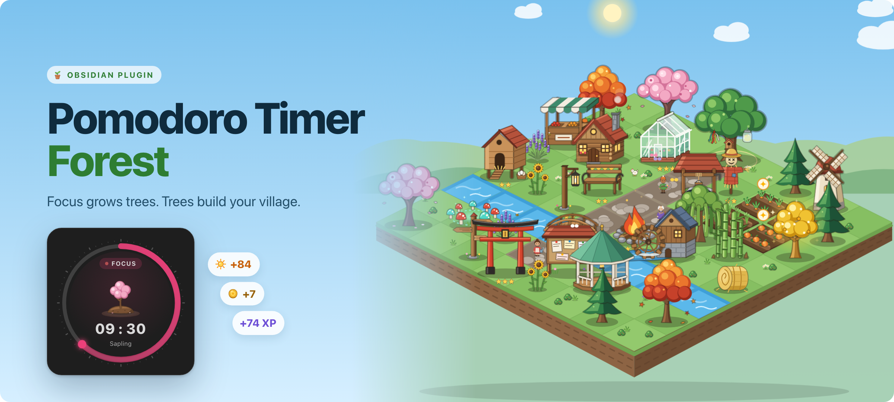

<b>Every focus session grows a tree. Every tree builds your village. All inside Obsidian.</b>

<a href="docs/GUIDE.md">Guide</a> · <a href="#quick-start">Quick start</a> · <a href="docs/GUIDE.md#kanban-boards">Boards</a> · <a href="docs/TIMER.md">Timer &amp; tasks</a> · <a href="docs/GUIDE.md#permissions-and-privacy">Privacy</a>

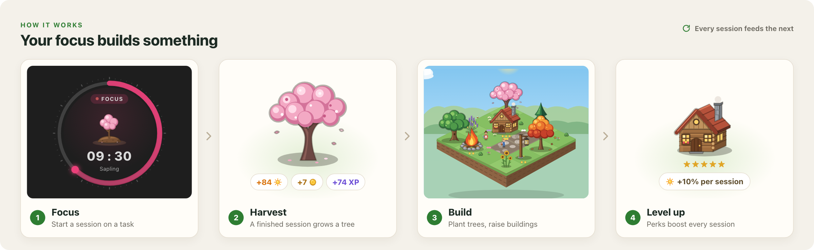

Built to motivate, not to nag. Missed days make the village sleepy, never broken, and nothing you build is ever taken away.

## Watch your tree grow

Press play and a seed is planted inside the timer. It grows into a tree as the ring fills. Finish and you harvest it; give up early and it withers.

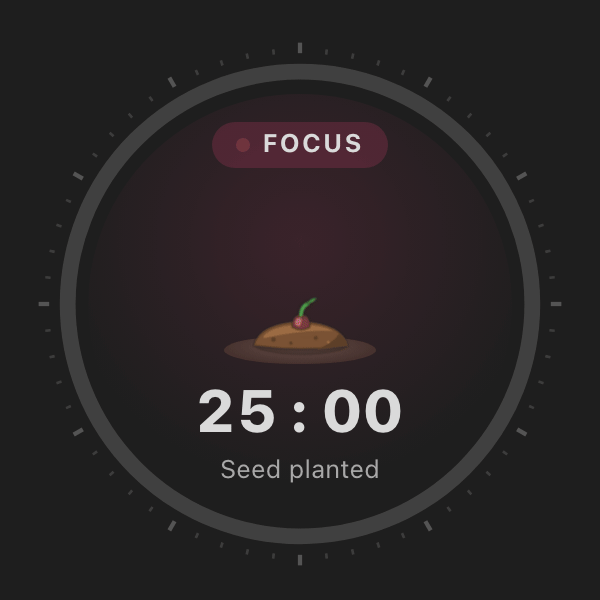

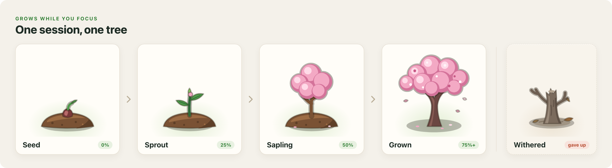

[More on growing trees →](docs/GUIDE.md#growing-trees)

## 🌊 Hyperfocus: ride the wave

When flow hits, roll straight into an open-ended session: no alarm, gentle check-ins, and a tree that never withers. [More →](docs/GUIDE.md#hyperfocus-mode-ride-the-wave)

## Build a village you're proud of

Spend what you earn on buildings with real perks, plant your saplings, grow crops with your focus and expand your island from 5×5 to 8×8. Open it as a full page, or keep it under the timer.

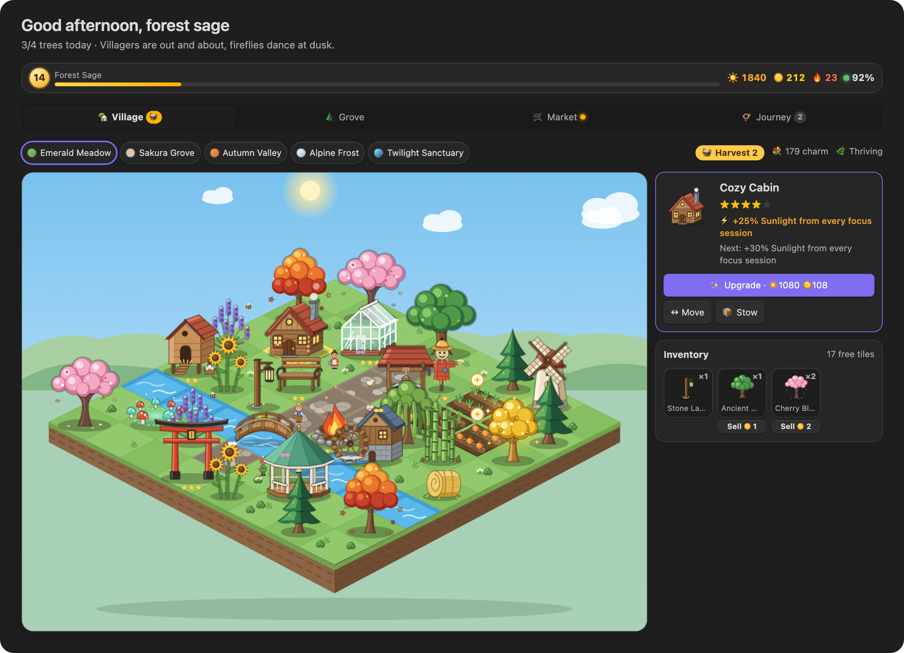

[More on building →](docs/GUIDE.md#building-your-village)

## Something to aim for

Quests are for today; the **Village Charter** is for the months ahead. Your settlement climbs from Clearing to City through seven ranks, each earned by a short chapter of goals and rewarded with a landmark you can't buy. Along the way, four named neighbours pin small requests tied to real work, and their friendship unlocks permanent keepsake perks. Nothing expires, and ranks are never lost.

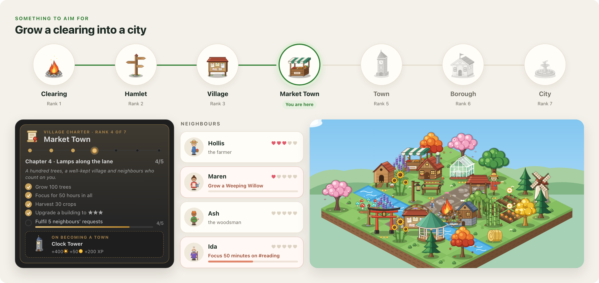

[More on the charter →](docs/GUIDE.md#the-village-charter) · [Neighbours →](docs/GUIDE.md#neighbours-and-their-requests)

## Your Heart Tree

Some things can't be bought. Quests, the daily chest, neighbours' requests and charter chapters leave care items and ornaments glinting in your village for you to pick up. Choose one tree as your **Heart Tree**, meet its small daily need, and it grows from Young to Elder, stands taller, and wears the ornaments you've found. A missed day costs nothing; it simply waits.

<table>
  <tr>
    <td align="center" valign="top" width="68%">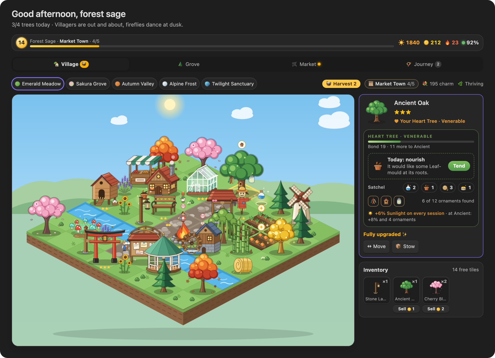</td>
    <td align="center" valign="top" width="32%">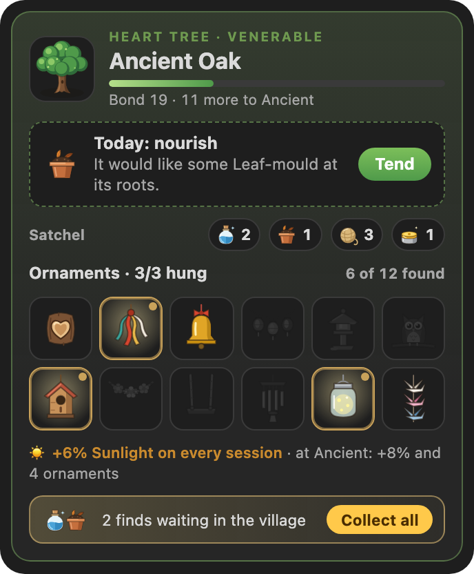</td>
  </tr>
</table>

[More on the Heart Tree →](docs/GUIDE.md#the-heart-tree-and-mission-finds)

## A village that lives on your clock

The sky follows your real time of day. Windows glow at dusk, villagers gather at the campfire after dark, and one session wakes a sleepy village back up.

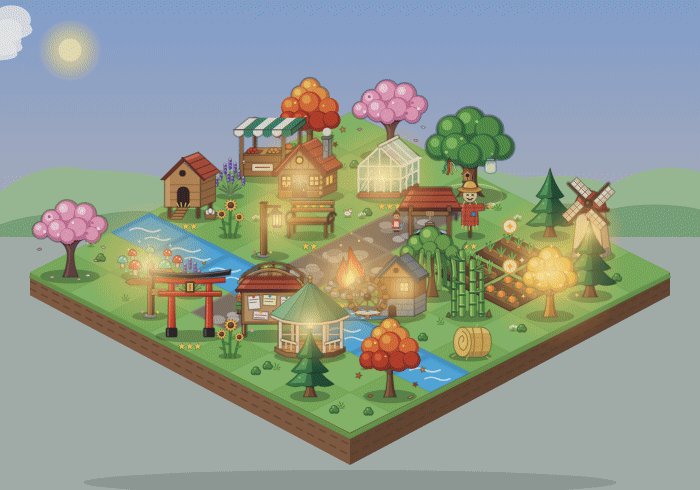

[More on villagers →](docs/GUIDE.md#villagers-and-hens)

## Five biomes, eleven species, two dozen buildings

Level up to unlock more, from a humble Classic Pine to a glowing Celestial Gold Tree.

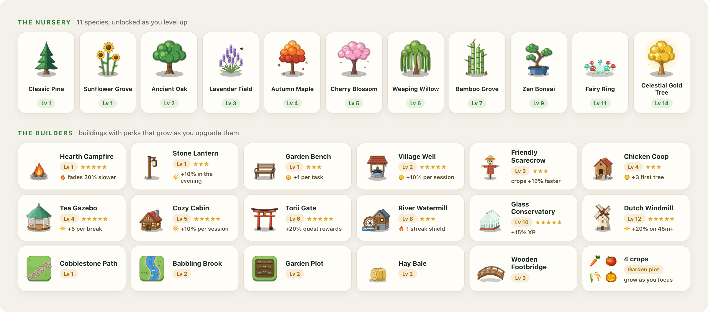

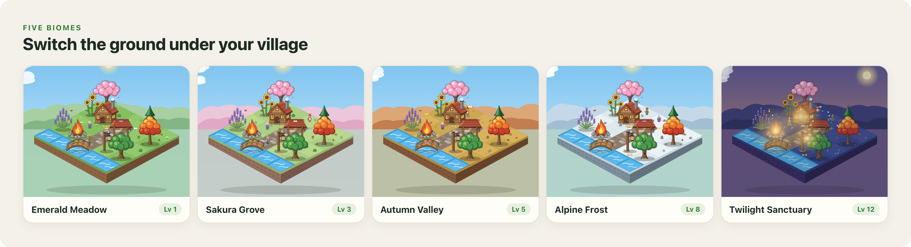

[More on levels and unlocks →](docs/GUIDE.md#levels-and-unlocks)

## Everything in the sidebar

<table>
  <tr>
    <td align="center" valign="top" width="25%">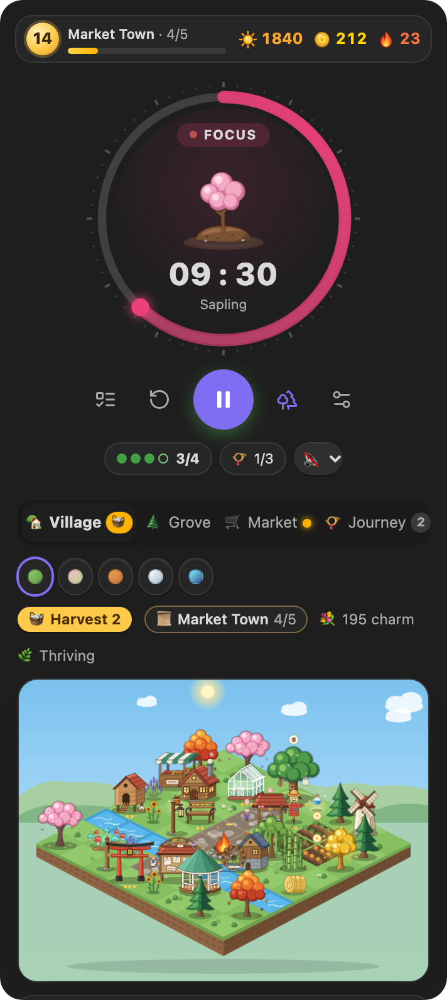 <b>Focus &amp; village</b> Your tree, today's goal, your village.</td>
    <td align="center" valign="top" width="25%">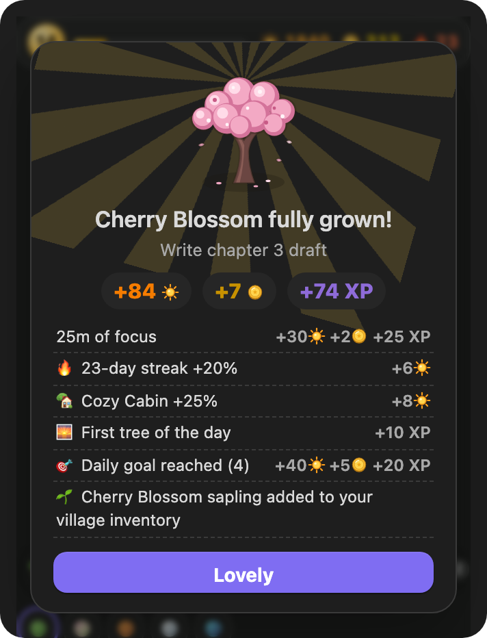 <b>Harvest</b> Every bonus, itemised.</td>
    <td align="center" valign="top" width="25%">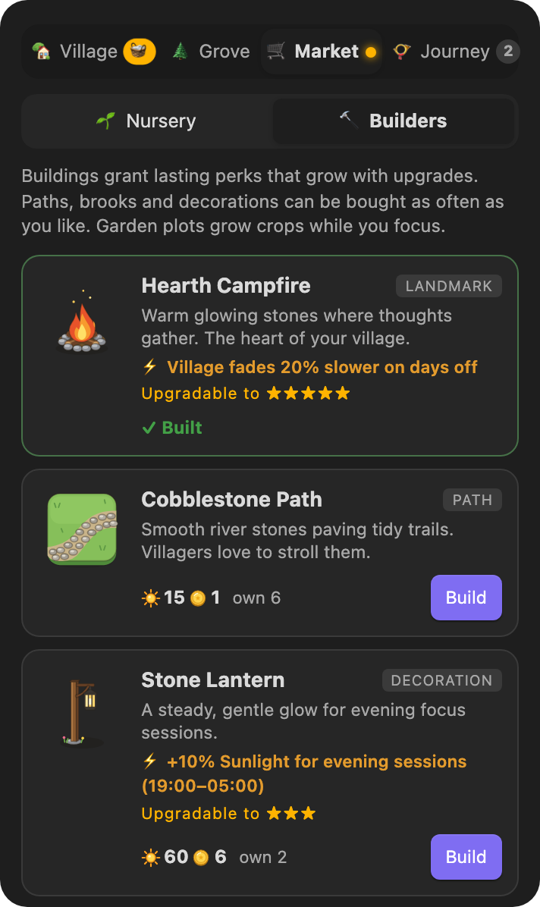 <b>Market</b> Buildings with real perks.</td>
    <td align="center" valign="top" width="25%">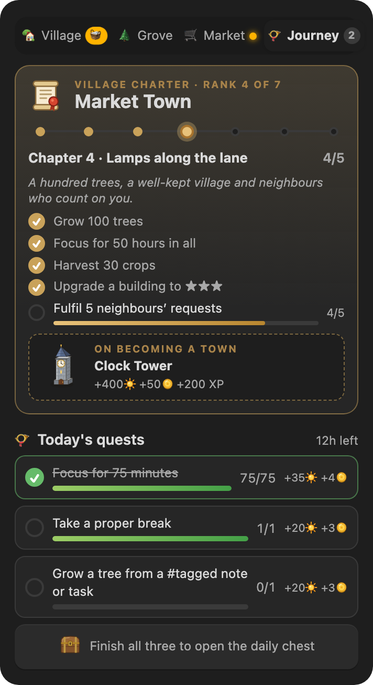 <b>Journey</b> Quests, achievements, stats.</td>
  </tr>
</table>

## Kanban boards that keep work moving

Plan in lanes, press play on a card, and get rewarded for finishing it. Boards use the [Kanban plugin](https://github.com/mgmeyers/obsidian-kanban)'s file format, so the boards you already have open as they are.

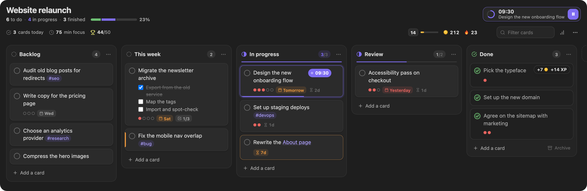

<table>
  <tr>
    <td align="center" valign="top" width="38%">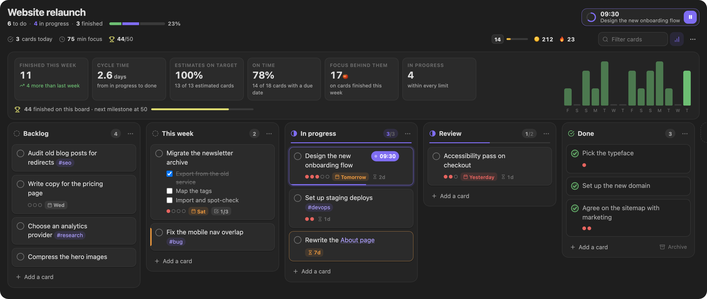 <b>Statistics</b>: throughput, cycle time, estimates.</td>
    <td align="center" valign="top" width="38%">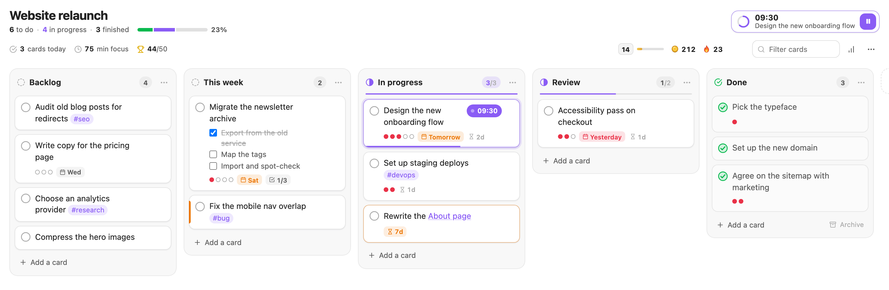 <b>Light or dark</b>: follows your theme.</td>
    <td align="center" valign="top" width="24%">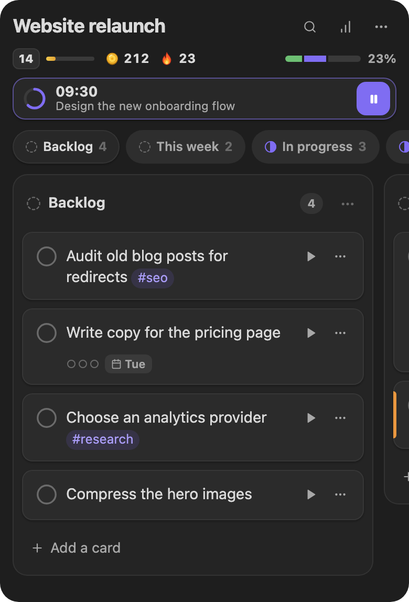 <b>On a phone</b>: one lane at a time.</td>
  </tr>
</table>

[More on boards →](docs/GUIDE.md#kanban-boards)

## Made for how you work in Obsidian

- ✅ **Tick a task, earn a reward.** Any `- [ ]` task in your vault. [Rewards](docs/GUIDE.md#rewards)
- 🌿 **Done early? Harvest early.** Finish the task, keep most of the reward. [How](docs/GUIDE.md#done-early-harvest-early)
- 🏷️ **Smart seeds.** `#write` plants a Cherry Blossom, `#code` a Pine. [Tags](docs/GUIDE.md#smart-seeds-tags)
- 🍅 **Task tracking.** Pomodoro counts, dates and pinned notes. [Tasks](docs/TIMER.md#task-tracking)
- 📓 **Daily-note logging.** Dataview-friendly lines for every session. [Logs](docs/TIMER.md#log)
- 🌲 **The Grove journal.** Any past day as a small island of trees. [Grove](docs/GUIDE.md#the-grove-journal)
- 🎧 **Ambient soundscapes.** Rain, a stream or a breeze, no audio files. [Sounds](docs/GUIDE.md#sounds)
- 📤 **Share your village.** A self-contained, animated HTML snapshot. [Export](docs/GUIDE.md#export-and-sharing)

<table>
  <tr>
    <td align="center" valign="top" width="50%">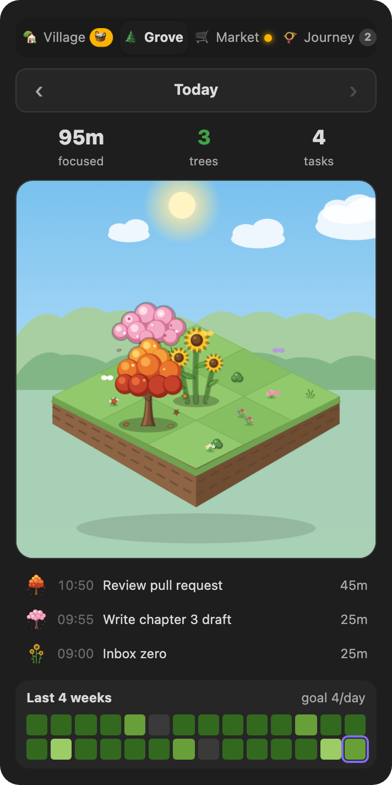 <b>The Grove</b>: today's trees and a four-week map.</td>
    <td align="center" valign="top" width="50%">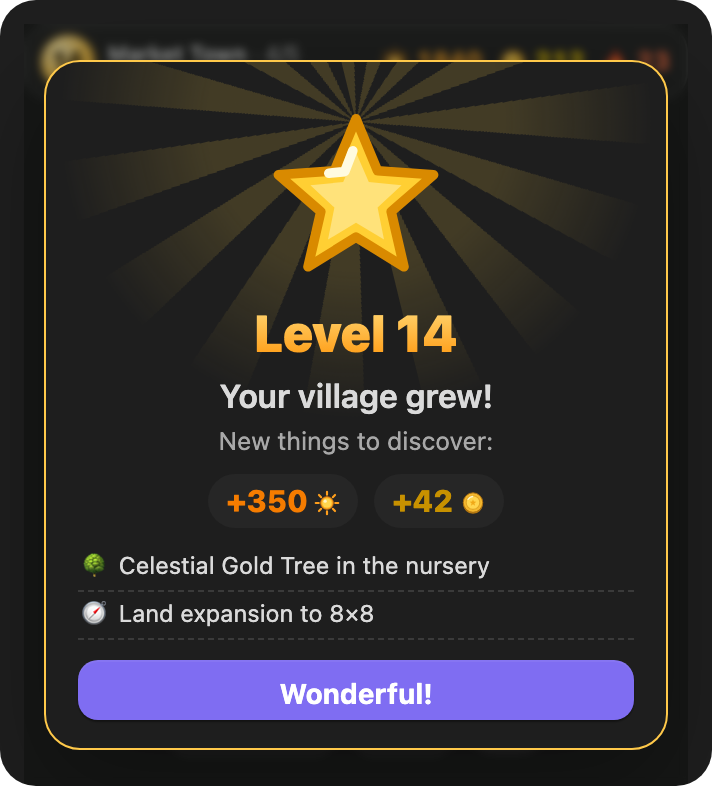 <b>Level up</b>: new species, buildings and land.</td>
  </tr>
</table>

## Quick start

1. **Install.** Copy `main.js`, `manifest.json` and `styles.css` into `<your vault>/.obsidian/plugins/pomodoro-timer-forest/`, then enable the plugin under *Settings → Community plugins*.
2. **Open it.** Click the timer icon in the ribbon. The trees icon opens the full-page village.
3. **Press play.** Your first tree (Classic Pine) is free, and you start with a couple of saplings to plant.
4. **Keep going.** The [user guide](docs/GUIDE.md) explains rewards, quests, perks and streaks.

## Privacy & your data

No accounts, no network requests, no telemetry. Your progress lives in one file in your vault, `.obsidian/plugins/pomodoro-timer-forest/data.json`, and the plugin only touches your notes for features you turn on. Sync that file to take your village to another device, and back it up before you uninstall: removing the plugin deletes it. Details: [permissions](docs/GUIDE.md#permissions-and-privacy), [several devices](docs/GUIDE.md#using-more-than-one-device), [uninstalling safely](docs/GUIDE.md#uninstalling-without-losing-your-progress).

## Credits

Built on [**Pomodoro Timer for Obsidian**](https://github.com/eatgrass/obsidian-pomodoro-timer) by eatgrass (MIT), which provides the timer, task tracking and logging. The Forest & Homestead game layer is added on top.

Building from source, tests and releases: [docs/DEVELOPMENT.md](docs/DEVELOPMENT.md).

Screenshots are rendered by the plugin's own components and renderer, using a sample level-14 village.
