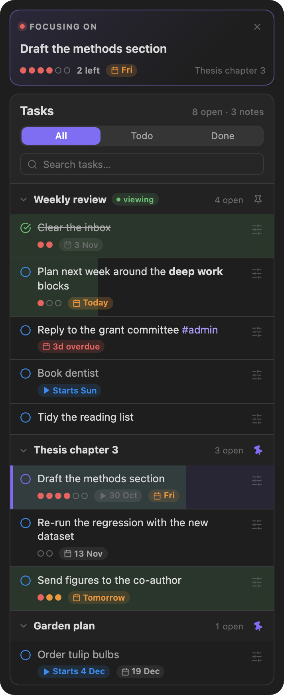
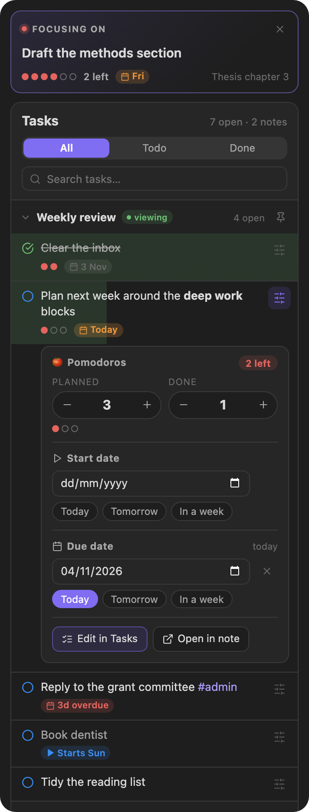

# Timer, tasks and logging

The game layer sits on top of a full-featured Pomodoro timer for Obsidian. This page covers the classic timer features. For trees, the village, boards and hyperfocus, see the [user guide](GUIDE.md).

- **Customizable timer.** Set your work and break intervals to suit how you work.
- **Audible alerts.** A sound marks the end of each session.
- **Status bar display.** Keep an eye on the timer from Obsidian's status bar.
- **Daily note integration.** Log your sessions in your daily notes automatically.
- **Task tracking.** Plan pomodoros, set start and due dates and pin several notes from the task panel, with the count kept up to date for the task in focus.

Contents:

- [Custom notification sound](#custom-notification-sound)
- [Task tracking](#task-tracking)
  - [Typing it by hand](#typing-it-by-hand)
- [Log](#log)
  - [Log formats](#log-formats)
  - [Custom log template (optional)](#custom-log-template-optional)
- [Using it with Dataview](#using-it-with-dataview)
- [CSS variables](#css-variables)
- [FAQ](#faq)

## Custom notification sound

1. Put the audio file into your vault.
2. Set its path relative to the vault's root.
   For example, if your audio file is in `AudioFiles` and named `notification.mp3`, the path is `AudioFiles/notification.mp3`.
   **Don't forget the file extension (`.mp3`, `.wav` and so on).**
3. Click the **play** button next to the path to check the sound.

## Task tracking

The **Tasks** panel (the checklist icon under the timer) lists the tasks of the note you are working in, plus every note you have pinned.

<table>
  <tr>
    <td align="center" valign="top" width="50%"><br><sub><b>One list, several notes</b><br>The note you are in, plus everything you pinned.</sub></td>
    <td align="center" valign="top" width="50%"><br><sub><b>Plan without typing</b><br>Pomodoros, start date and due date, right under the task.</sub></td>
  </tr>
</table>

- **Focus a task** by clicking it. The timer counts its pomodoros, and the session is logged against it. Right-click a task for more actions.
- **Pin notes.** Click the pin next to a note's name to keep its tasks in the panel while you work in other notes. Pin as many notes as you like; pins are remembered between sessions. When you open another note, its tasks appear first, followed by your pinned notes. A task you are focusing on stays focused while its note is pinned, or while a focus session is running.
- **Plan and schedule from the panel.** The sliders button on a task opens its editor: how many pomodoros it should take, how many are done (with the number left shown), a start date and a due date. Changes are written straight to the task's line in your note, and the rest of the line is left alone.
- **Edit in Tasks.** With the [Tasks](https://github.com/obsidian-tasks-group/obsidian-tasks) plugin installed, the editor also has an **Edit in Tasks** button. It opens the Tasks plugin's own editor (priority, recurrence, every date, status) through the plugin's public API and writes the result back to the line.
- **Count sessions automatically.** Turn on *Enable task tracking* in the settings. Every finished focus session then adds one to the focused task's count. Without it, the panel still works, and you can adjust the count by hand.

This is what ends up in your note:

```markdown
- [ ] Draft the methods section [🍅:: 4/6] 🛫 2025-09-25 📅 2025-10-03
```

`4/6` is four pomodoros done out of six planned. Dates follow the *Task format* setting: the Tasks emoji format shown above, or Dataview fields (`[start:: 2025-09-25] [due:: 2025-10-03]`).

### Typing it by hand

The panel is optional; you can still write the field yourself after the task's text. Enable tracking in the settings and the timer updates the count at the end of each work session.

**Put this inline field before the [Tasks](https://github.com/obsidian-tasks-group/obsidian-tasks) plugin's fields.** Anywhere else, the Tasks plugin may render the task incorrectly. The panel always puts it in the right place.

```markdown
- [ ] Task with both expected and actual pomodoros [🍅:: 3/10]
- [ ] Task with only the actual pomodoros [🍅:: 5]
- [ ] With the Tasks plugin enabled [🍅:: 5] ➕ 2023-12-29 📅 2024-01-10
```

## Log

### Log formats

These are the standard log formats. For more detailed logging, set up a [custom log template](#custom-log-template-optional) as described below.

**Simple**

```
**WORK(25m)**: 20:16 - 20:17
**BREAK(25m)**: 20:16 - 20:17
```

**Verbose**

```plain
- 🍅 (pomodoro::WORK) (duration:: 25m) (begin:: 2023-12-20 15:57) - (end:: 2023-12-20 15:58)
- 🥤 (pomodoro::BREAK) (duration:: 25m) (begin:: 2023-12-20 16:06) - (end:: 2023-12-20 16:07)
```

### Custom log template (optional)

1. Install the [Templater](https://github.com/SilentVoid13/Templater) plugin.
2. Write your log template script using the `log` object, which holds the session's information:

```javascript
// TimerLog
{
    duration: number,  // duration in minutes
    session: number,   // session length
    finished: boolean, // whether the session finished
    mode: string,      // 'WORK' or 'BREAK'
    begin: Moment,     // start time
    end: Moment,       // end time
    task: TaskItem,    // focused task
}

// TaskItem
{
    path: string,         // task file path
    fileName: string,     // task file name
    text: string,         // the full text of the task
    name: string,         // editable task name (default: task description)
    status: string,       // task checkbox symbol
    blockLink: string,    // block link id of the task
    checked: boolean,     // whether the task's checkbox is checked
    done: string,         // done date
    due: string,          // due date
    created: string,      // created date
    cancelled: string,    // cancelled date
    scheduled: string,    // scheduled date
    start: string,        // start date
    description: string,  // task description
    priority: string,     // task priority
    recurrence: string,   // task recurrence rule
    tags: string[],       // task tags
    expected: number,     // expected pomodoros
    actual: number,       // actual pomodoros
}
```

Here is an example:

```javascript
<%*
if (log.mode == "WORK") {
  if (!log.finished) {
    tR = `🟡 Focused ${log.task.name} ${log.duration} / ${log.session} minutes`;
  } else {
    tR = `🍅 Focused ${log.task.name} ${log.duration} minutes`;
  }
} else {
  tR = `☕️ Took a break from ${log.begin.format("HH:mm")} to ${log.end.format(
    "HH:mm"
  )}`;
}
%>
```

## Using it with Dataview

These scripts read the [verbose log format](#log-formats).

### Log table

A table of Pomodoro sessions with their durations, start and end times.


````markdown
```dataviewjs
const pages = dv.pages()
const table = dv.markdownTable(['Pomodoro','Duration', 'Begin', 'End'],
pages.file.lists
.filter(item=>item.pomodoro)
.sort(item => item.end, 'desc')
.map(item=> {

    return [item.pomodoro, `${item.duration.as('minutes')} m`, item.begin, item.end]
})
)
dv.paragraph(table)
```
````

### Summary view

A summary of Pomodoro sessions, grouped by date.


````markdown
```dataviewjs
const pages = dv.pages();
const emoji = "🍅";
dv.table(
  ["Date", "Pomodoros", "Total"],
  pages.file.lists
    .filter((item) => item?.pomodoro == "WORK")
    .groupBy((item) => {
      if (item.end && item.end.length >= 10) {
        return item.end.substring(0, 10);
      } else {
        return "Unknown Date";
      }
    })
    .map((group) => {
      let sum = 0;
      group.rows.forEach((row) => (sum += row.duration.as("minutes")));
      return [
        group.key,
        group.rows.length > 5
          ? `${emoji}  ${group.rows.length}`
          : `${emoji.repeat(group.rows.length)}`,
        `${sum} min`,
      ];
    })
)
```
````

## CSS variables

| Variable                         | Default              |
| -------------------------------- | -------------------- |
| `--pomodoro-timer-color`         | `var(--text-faint)`  |
| `--pomodoro-timer-elapsed-color` | `var(--color-green)` |
| `--pomodoro-timer-text-color`    | `var(--text-normal)` |
| `--pomodoro-timer-dot-color`     | `var(--color-red)`   |

## FAQ

**How do I switch the session?**
Click the `Work/Break` label on the timer.

**How do I turn off `Break` sessions completely?**
Set the break interval to `0`.
